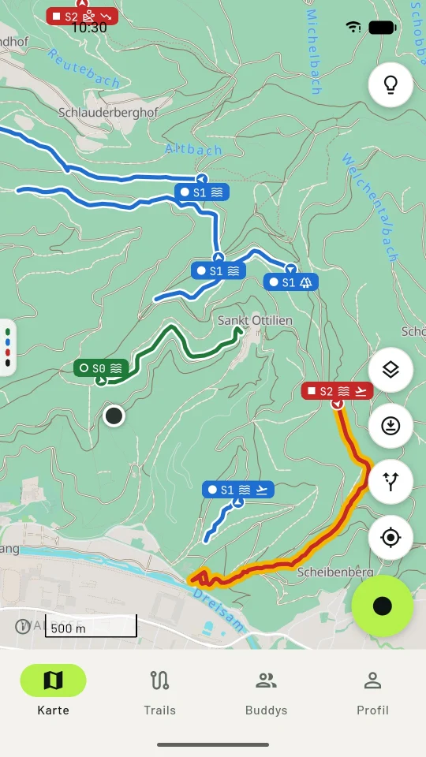
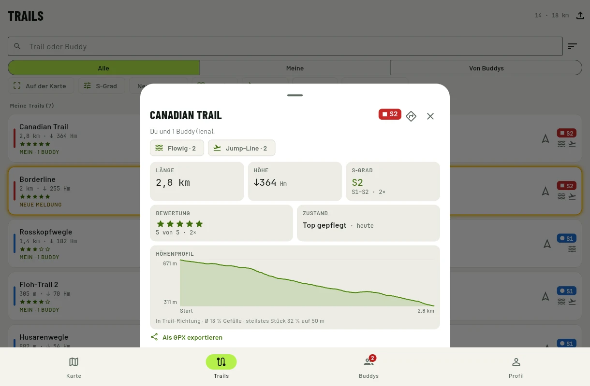
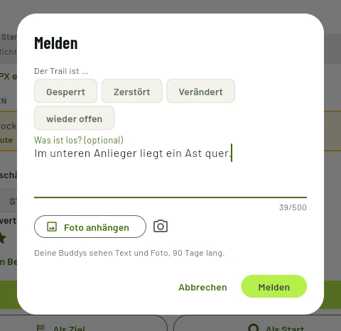
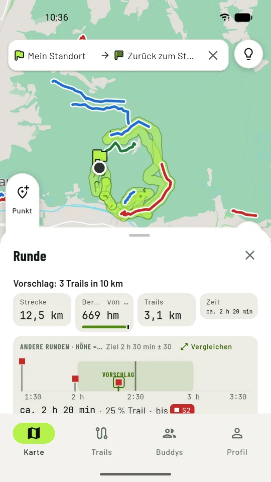
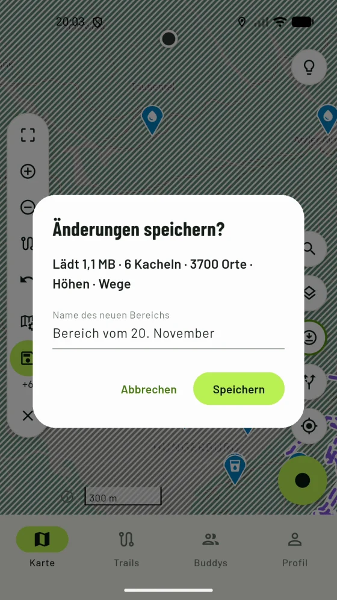
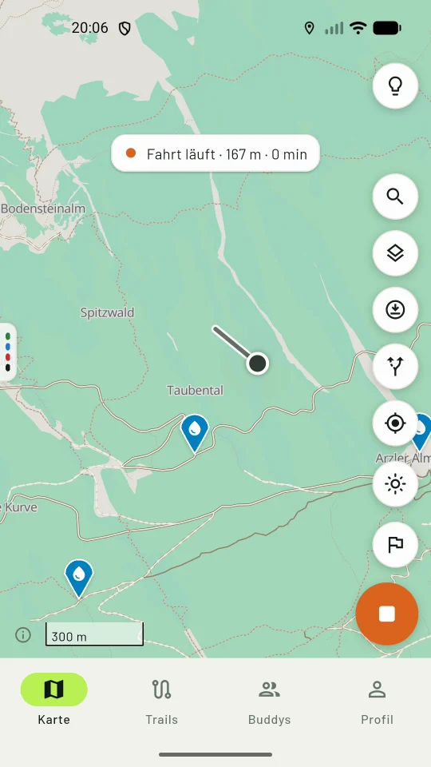
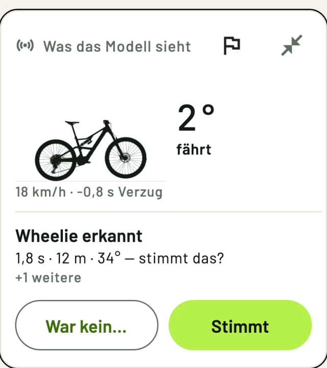

<a href="README.md" lang="de">Deutsch</a> · <strong>English</strong>

# TrailBuddy

TrailBuddy is a mountain biking app for your personal trail network. Share the
trails you ride with your buddies, discover their contributions, and use them
to plan your next loop.

[**Open the web app**](https://macbuchi.github.io/trailbuddy/) ·
[**Install the Android app**](https://github.com/MacBuchi/trailbuddy/releases/latest) ·
[**Garmin watch app**](#garmin)

  
  

*Android and web with demo data.*

## Android and web compared

| Feature | Android | Web |
| --- | --- | --- |
| Trail map, search, and filters | ✓ | ✓ |
| Import trails from GPX files | ✓ | ✓ |
| Buddies and messages | ✓ | ✓ |
| Trail conditions and photo reports | ✓ | ✓ |
| Plan loops and routes | ✓ | ✓ |
| Offline maps | Custom areas and entire regions | Custom areas in the browser |
| Record a GPS ride | ✓ | — |
| Sensor detection for wheelies, jumps, and stoppies (experimental) | ✓ | — |
| Connect a Garmin watch | ✓ | — |

## What makes TrailBuddy different

### Message your buddies

Use the buddy chat to arrange a ride, agree on a meeting point, or ask
where to start. Open the chat using the speech bubble next to the buddy’s name.

### Share trail conditions and reports

Rate a trail and add your take on its difficulty. If a tree is down after
a storm or the trail has reopened, report it directly on the trail. Add a
short note and a photo to show your buddies what to expect.

### Plan loops with MTB-specific routing

Set a starting point, time, and climbing budget, then compare suggested
loops by ride time, ascent, and difficulty. TrailBuddy builds routes around
trails in your network. Descents are routed in the riding direction unless
they are explicitly marked as two-way. Marked uphill trails and links can
connect the other parts of the route.

### Save maps and routing data for offline use

Draw the area you want to save on the map. Where available, TrailBuddy also
downloads elevation, places, and path data. The saved paths let you plan
within the area without a signal. Overlapping areas share tiles, and later downloads fetch
only missing data. Android can also download entire map regions.

## Android only

### Record rides and detect jumps

Record a GPS track with the screen off. After the ride, save sections as
trails and share them with buddies. The optional **experimental sensor
detection** under “About TrailBuddy” looks for wheelies, jumps, and stoppies
during rides. Confirm or dismiss detected events in the live view.

  
  

*Ride recording and sensor view with simulated measurements.*

## Garmin

The Connect IQ app displays a route sent from your Android phone and vibrates
when you leave the route. It can record a ride on its own and later transfer
it to TrailBuddy on your Android phone through Garmin Connect.

The watch app was tested on a fēnix 5. The [Garmin manifest](garmin/manifest.xml)
lists the other build targets. See the
[build and USB setup notes](garmin/CLAUDE.md#technik-notizen) in German.

## More about TrailBuddy

[What's new](CHANGELOG.en.md) ·
[Roadmap](https://github.com/MacBuchi/trailbuddy/issues/520) ·
[Trail concept](docs/konzept-trails.md) ·
[Contributing](CLAUDE.md)
