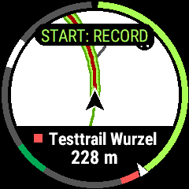

<a href="README.md" lang="de">Deutsch</a> · <strong>English</strong>

# TrailBuddy

TrailBuddy is a mountain biking app for your personal trail network. Share the
trails you ride with your buddies, discover their contributions, and use them
to plan your next loop.

[**Open the web app**](https://macbuchi.github.io/trailbuddy/) ·
[**Install the Android app**](https://github.com/MacBuchi/trailbuddy/releases/latest) ·
[**Garmin watch app**](#garmin)

  
  

*Android and web with demo data.*

## Android and web compared

| Feature | Android | Web |
| --- | --- | --- |
| Trail map, search, and filters | ✓ | ✓ |
| Import trails from GPX files | ✓ | ✓ |
| Buddies and messages | ✓ | ✓ |
| Plan loops and routes | ✓ | ✓ |
| Offline maps | Custom areas and entire regions | Custom areas in the browser |
| Record a GPS ride | ✓ | — |
| Connect a Garmin watch | ✓ | — |

## Garmin

The Connect IQ app displays a route sent from your Android phone and vibrates
when you leave the route. It can record a ride on its own and later transfer
it to TrailBuddy on your Android phone through Garmin Connect.

The watch app was tested on a fēnix 5. The [Garmin manifest](garmin/manifest.xml)
lists the other build targets. See the
[build and USB setup notes](garmin/CLAUDE.md#technik-notizen) in German.

## More about TrailBuddy

[What's new](CHANGELOG.en.md) ·
[Roadmap](https://github.com/MacBuchi/trailbuddy/issues/520) ·
[Trail concept](docs/konzept-trails.md) ·
[Contributing](CLAUDE.md)
