
<strong>Deutsch</strong> · <a href="README.en.md" lang="en">English</a>

# TrailBuddy

TrailBuddy ist eine Mountainbike-App für dein persönliches Trail-Netz. Du teilst
gefahrene Trails mit deinen Buddys, entdeckst ihre Beiträge und planst damit
deine nächste Runde.

[**Web-App öffnen**](https://macbuchi.github.io/trailbuddy/) ·
[**Android-App installieren**](https://macbuchi.github.io/trailbuddy/install.html) ·
[**Garmin-Uhr-App**](#garmin)

  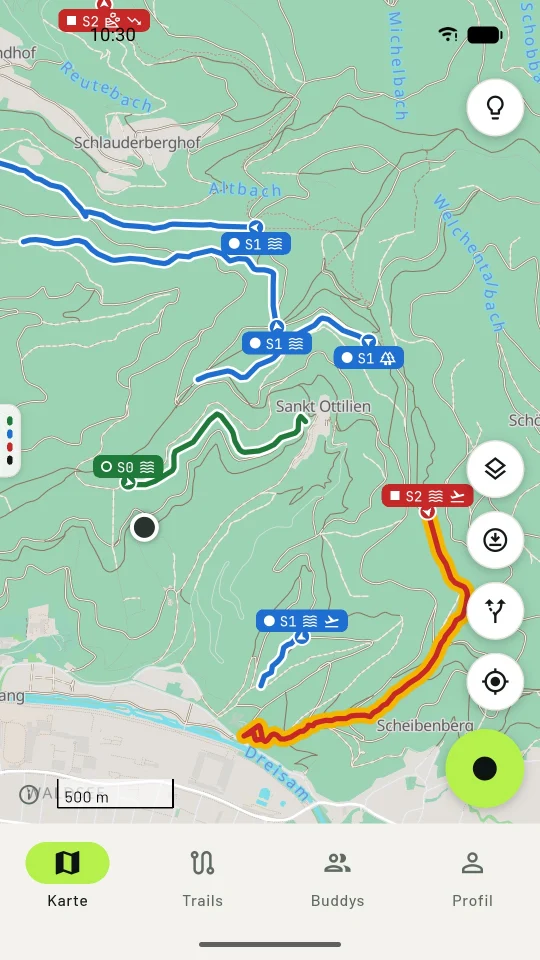
  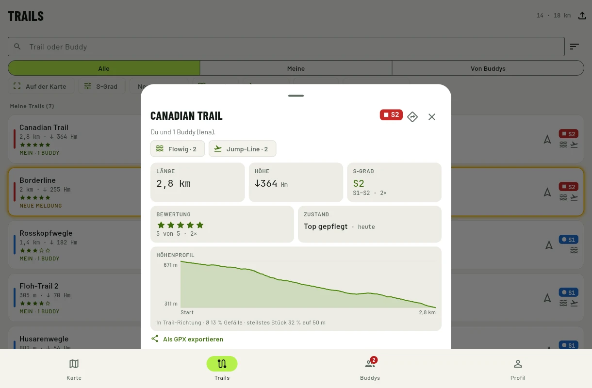

*Android und Web mit Demodaten.*

## Android und Web im Vergleich

| Funktion | Android | Web |
| --- | --- | --- |
| Trail-Karte, Suche und Filter | ✓ | ✓ |
| Trails aus GPX-Dateien importieren | ✓ | ✓ |
| Buddys und Nachrichten | ✓ | ✓ |
| Trail-Zustand und Meldungen mit Foto | ✓ | ✓ |
| Runden und Routen planen | ✓ | ✓ |
| Offline-Karten | Eigene Bereiche und ganze Regionen | Eigene Bereiche im Browser |
| GPS-Fahrt aufzeichnen | ✓ | — |
| Sensor-Erkennung für Wheelies, Sprünge und Stoppies (Test) | ✓ | — |
| Garmin-Uhr verbinden | ✓ | — |

## Was TrailBuddy ausmacht

### Mit Buddys schreiben

Verabrede dich direkt im Buddy-Chat, etwa für die nächste Runde, einen
Treffpunkt oder eine Empfehlung für den besten Einstieg. Den Chat öffnest
du über die Sprechblase neben dem jeweiligen Buddy.

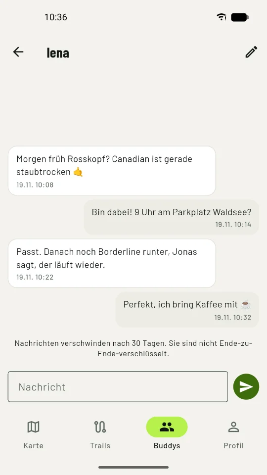

### Zustand und Hinweise am Trail teilen

Bewerte den Trail und schätze seine Schwierigkeit ein. Liegt nach dem
Sturm ein Baum quer oder ist der Trail wieder offen, kannst du das direkt
am Trail melden. Ein kurzer Text und ein Foto zeigen deinen Buddys, was sie
vor Ort erwartet.

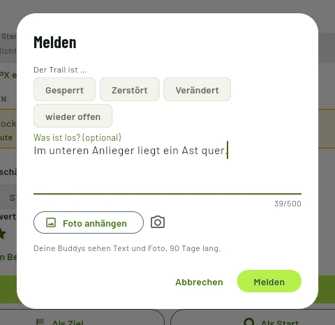

### MTB-Runden mit eigener Trail-Logik planen

Wähle Start, Zeit und Höhenmeter und vergleiche Rundenvorschläge nach
Fahrzeit, Anstieg und Schwierigkeit. TrailBuddy baut die Trails deines Netzes
in die Route ein. Abfahrtstrails plant es in Fahrtrichtung, sofern sie
nicht ausdrücklich in beiden Richtungen fahrbar sind. Markierte
Uphill-Trails und Verbindungen kommen als Zubringer infrage.

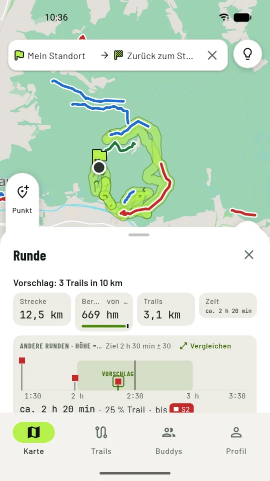

### Offline-Karte und Routing zusammen speichern

Zeichne den gewünschten Bereich auf der Karte ein. Wo verfügbar, lädt
TrailBuddy auch Höhen-, Orts- und Wegedaten. Mit den gespeicherten Wegedaten
kannst du innerhalb des Bereichs auch ohne Empfang planen. Überlappende
Bereiche teilen sich Kacheln, und weitere Downloads holen nur fehlende
Daten nach.
Unter Android kannst du auch ganze Kartenregionen herunterladen.

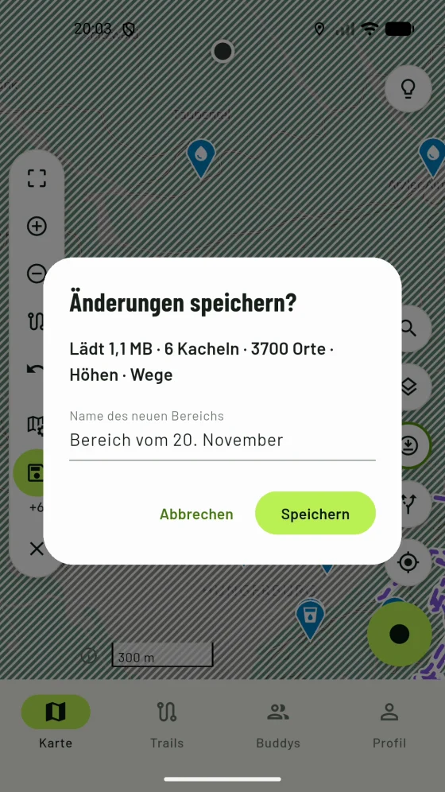

## Nur auf Android

### Fahrt aufzeichnen und Sprünge erkennen

Zeichne deine GPS-Spur auch bei ausgeschaltetem Bildschirm auf. Nach der
Fahrt kannst du einzelne Abschnitte als Trails übernehmen und mit Buddys
teilen. Die optionale **Sensor-Erkennung (Test)** unter „Über TrailBuddy“
sucht während der Fahrt nach Wheelies, Sprüngen und Stoppies. In der
Live-Ansicht kannst du erkannte Ereignisse bestätigen oder verwerfen.

  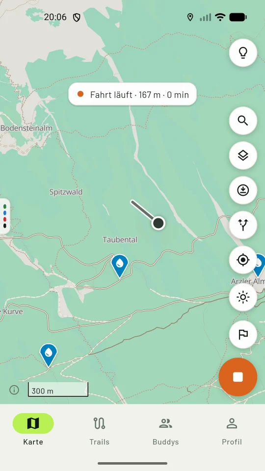
  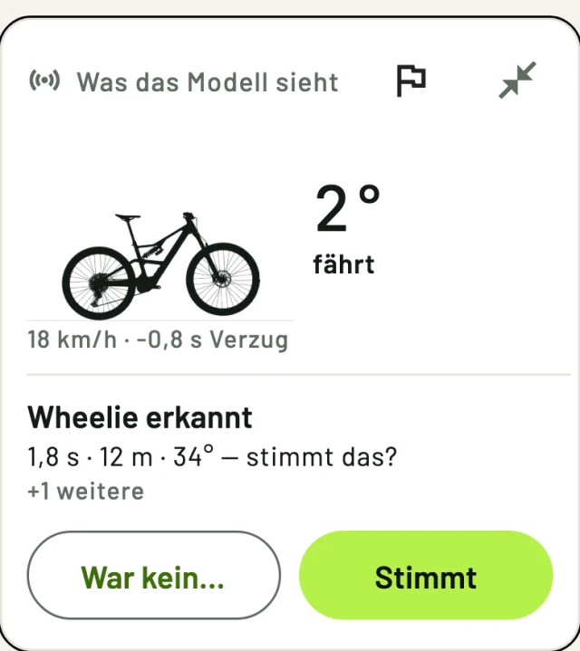

*Fahrtaufzeichnung und Sensor-Ansicht mit simulierten Messdaten.*

## Garmin

  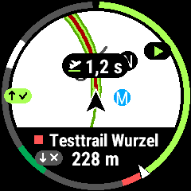
  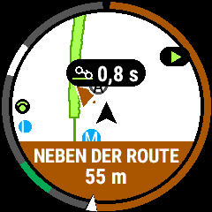
  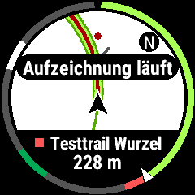

[Alle Garmin-Ansichten auf Deutsch](garmin/shots/fenix5/deu).

Die Connect-IQ-App zeigt die vom Android-Handy gesendete Route an und
vibriert beim Verlassen der Route. Sie kann eine Fahrt auch ohne Handy
aufzeichnen und sie später über Garmin Connect an TrailBuddy auf dem
Android-Handy übertragen.

Die Uhr-App wurde auf der fēnix 5 am Gerät geprüft. Die weiteren Build-Ziele
stehen im [Garmin-Manifest](garmin/manifest.xml). Für die Einrichtung per USB
siehe die [Bau- und Installationshinweise](garmin/CLAUDE.md#technik-notizen).

## Mehr über TrailBuddy

[Was ist neu?](CHANGELOG.md) ·
[Roadmap](https://github.com/MacBuchi/trailbuddy/issues/520) ·
[Trail-Konzept](docs/konzept-trails.md) ·
[Für Mitwirkende](CLAUDE.md)
